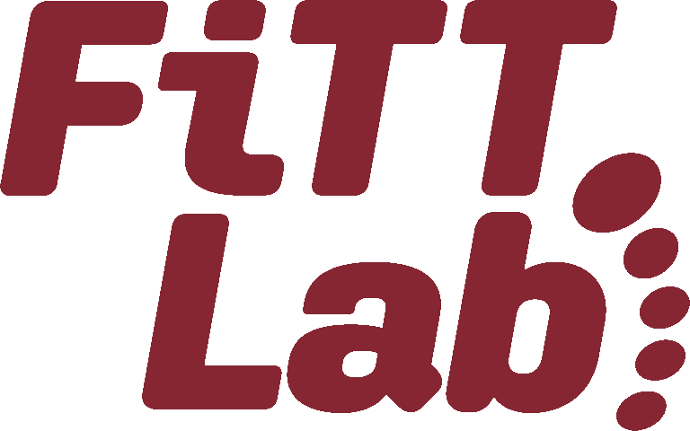
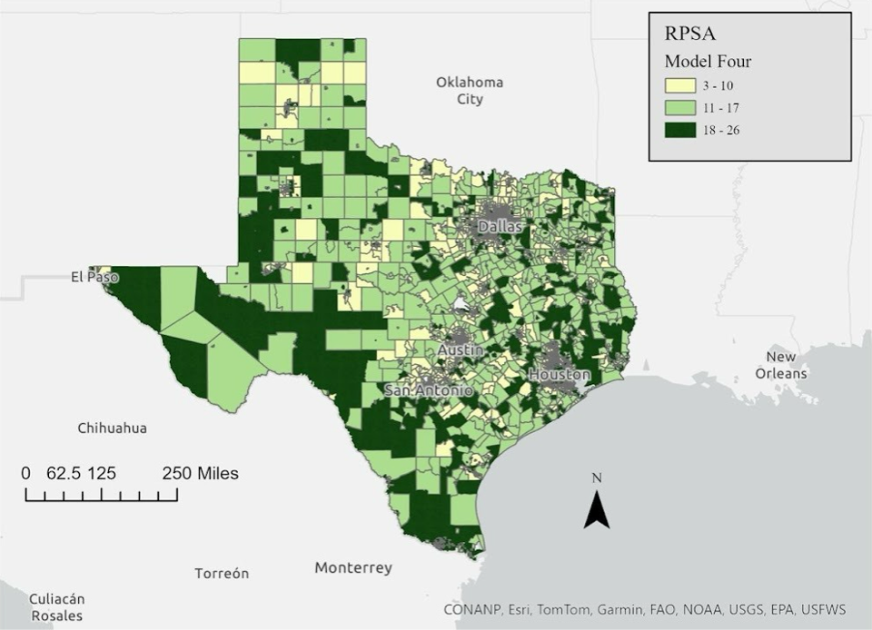
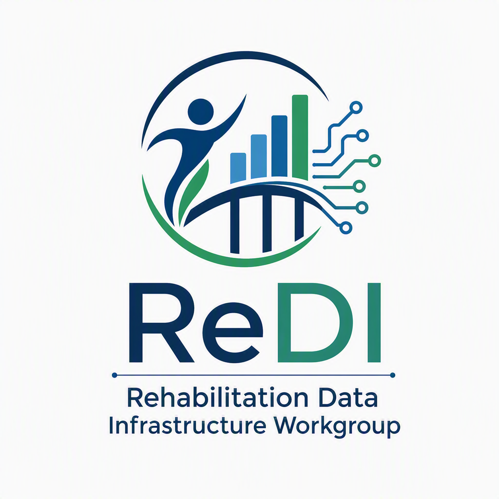

## Lab and Working Group Affiliations

::: {.grid}

::: {.g-col-12 .g-col-md-4 .card .p-3}
{width="100%" style="margin-bottom: 1rem;"}

### FITT Lab

Dr. Erin Futrell's FITT Lab where I am an Analytics Consultant (yes, I wore the minimalist shoes and yes, I still do my "toe yoga").

[Foot Intrinsic Testing and Training Lab](https://gulick.springfield.edu/fitt/){target="_blank"}
:::

::: {.g-col-12 .g-col-md-4 .card .p-3}
{width="100%" style="margin-bottom: 1rem;"}

### Rehab Maps Research Lab

Dr. Madeline Ratoza's Rehab Maps Research Lab — research on access and equity in physical therapy services using layered maps.

[Rehab Maps Research Lab](https://www.madelineratoza.com/rehab-maps-research-lab){target="_blank"}
:::

::: {.g-col-12 .g-col-md-4 .card .p-3}
{width="100%" style="margin-bottom: 1rem;"}

### ReDI

Rehabilitation Data Infrastructure Workgroup is a collaborative interdisciplinary working group that is advancing data infrastructure standards to advance learning health systems to promote rehabilitation research.
:::

:::